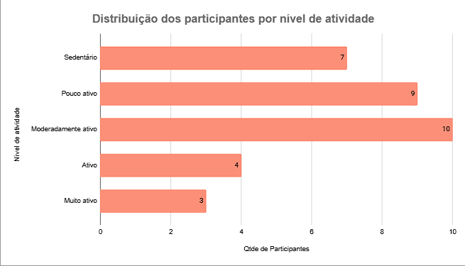
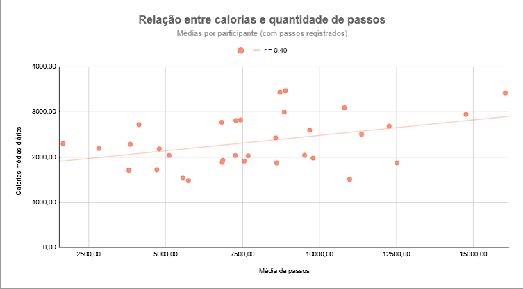
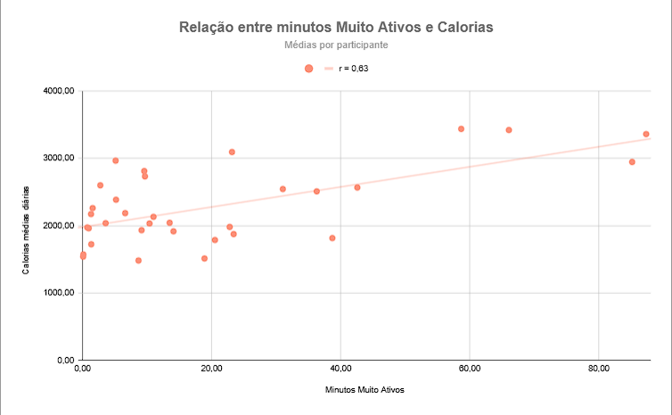
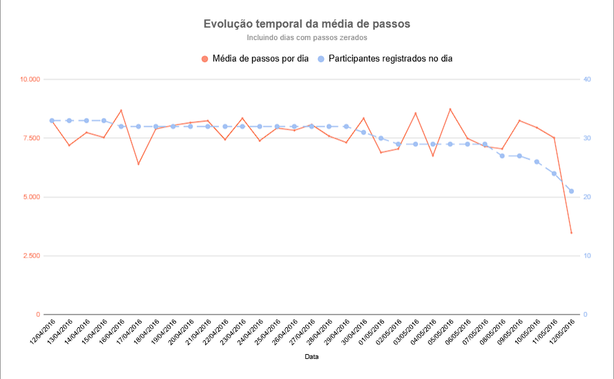

# Estudo de Caso Bellabeat — Análise de Dados de Atividade Física

## 1. Sobre o projeto

A Bellabeat é uma empresa de tecnologia que desenvolve produtos voltados ao monitoramento da saúde e do bem-estar feminino.

Este projeto foi desenvolvido como um estudo de caso de análise de dados como parte do curso "Google Data Analytics Capstone: Complete a Case Study", e tem como objetivo compreender os padrões de utilização de dispositivos inteligentes de monitoramento de atividade física e identificar oportunidades que possam contribuir para estratégias de marketing da Bellabeat.

A análise utiliza dados públicos de dispositivos Fitbit como referência exploratória, e os resultados não representam especificamente o comportamento dos consumidores da Bellabeat.

## 2. Objetivo e perguntas de negócio

**Objetivo:** compreender como os participantes utilizam dispositivos inteligentes e quais padrões de atividade física podem ser identificados nos registros.

As principais perguntas analisadas foram:

- Quais são os níveis de atividade física dos participantes, considerando a quantidade diária de passos?
- Qual é a relação entre passos, minutos de atividade intensa e calorias registradas?
- Como os níveis de atividade variam ao longo do período analisado?
- Quais oportunidades de marketing podem ser levantadas a partir dos resultados?

## 3. Fonte de dados e ferramentas

**Fonte:** [Fitbit Fitness Tracker Data — Kaggle](https://www.kaggle.com/datasets/arashnic/fitbit/data)

**Arquivo principal:** `dailyActivity_merged.csv`

**Período analisado:** 12/04/2016 a 12/05/2016.

**Base de dados:** 940 registros diários de 33 participantes.

**Ferramenta utilizada:** Google Sheets, para preparação, limpeza, análise exploratória, cálculos estatísticos e visualizações.

A planilha original está disponível para consulta, preservando as fórmulas, a organização das abas, o conjunto de dados e as visualizações utilizadas no projeto.

[Planilha "Estudo_de_Caso_Bellabeat"](https://docs.google.com/spreadsheets/d/168ZHWtuZipyKasfDN7dX3i5mtLGRLV8i-Lyi4nlMqjE/edit?gid=1956015245#gid=1956015245)

## 4. Preparação e limpeza dos dados

Foram realizadas as seguintes etapas:

- Tratamento e padronização das datas.
- Conversão e formatação de valores numéricos.
- Verificação de registros duplicados por participante e data.
- Investigação de registros com quantidade de passos igual a zero.
- Identificação de possíveis outliers pelo método do intervalo interquartil (IQR).
- Construção de métricas agregadas por participante.

Os registros com zero passos foram mantidos na análise principal, pois não havia evidências suficientes para classificá-los automaticamente como inválidos. Também foi realizada uma análise de sensibilidade para verificar o impacto de sua exclusão.

Os valores extremos identificados foram preservados, evitando a exclusão de observações sem justificativa suficiente.

## 5. Metodologia de análise

### Classificação dos níveis de atividades

Para a classificação dos níveis de atividades dos participantes, foi utilizado o cálculo da média diária de passos desconsiderando dias sem passos registrados, e os critérios de faixa de valores adaptados da literatura científica realizada por Tudor-Locke e Bassett no artigo ["How many steps/day are enough?"](https://pubmed.ncbi.nlm.nih.gov/14715035/).

| Nível de Atividade | Passos por dia |
|---|---:|
| Sedentário | Até 4.999 |
| Pouco ativo | De 5.000 a 7.499 |
| Moderadamente ativo | De 7.500 a 9.999 |
| Ativo | De 10.000 a 12.499 |
| Muito ativo | A partir de 12.500 |

A exclusão dos dias com zero passos constitui uma adaptação metodológica deste estudo, e os efeitos foram avaliados por meio da análise de sensibilidade.

### Classificação da disponibilidade dos dados

Durante a exploração dos dados foi identificado que os 33 participantes não possuíam quantidades semelhantes de registros durante o período analisado, então foram utilizados os seguintes critérios próprios para classificar a disponibilidade dos dados por participante:

| Classificação de Disponibilidade | Quantidade de Dias registrados |
|---|---:|
| Baixa Disponibilidade | Até 13 dias |
| Média Disponibilidade | De 14 a 20 dias |
| Alta Disponibilidade | A partir de 21 dias |

### Estatística descritiva

Foram realizados o cálculo e análise da média, mediana, mínimo, máximo, quartis e IQR, sendo esses últimos para a definição dos limites inferior e superior e identificar possíveis outliers.

Nessa etapa, foi identificado que os valores categorizados como outliers, totalizando 12 registros (representando aproximadamente 1,28% do total de registros), e que embora apresentem valores elevados não foram identificadas evidências suficientes para classificá-los como erros. Com isso, os registros foram preservados no conjunto utilizado para a análise.

### Correlações

Analisado e comparado a correlação de Pearson do gasto calórico com base na média de passos por dia e também com base na média de minutos ativos por dia, indicando que há associações positivas com o aumento no total de calorias, porém sem evidências suficientes para determinar que seriam a causa e efeito do gasto calórico, baseando-se que também há outros fatores demográficos não presentes nos dados que possam interferir no gasto calórico de cada participante.

Passos × calorias: r = 0,40, sem considerar dias com zero passos registrados. 
Minutos muito ativos × calorias: r = 0,63, considerando todos os dias do conjunto de dados.

*Obs.: ambos os cálculos foram realizados agregando as observações por participantes, por conta da diferença na quantidade de registros de cada participante.*

### Análise de sensibilidade

Para analisar o impacto dos registros com zero passos registrados, foi realizada a análise de sensibilidade sobre a média geral, a partir dos registros diários, e a classificação dos participantes, através de médias individuais, comparando os dois cenários: incluindo e excluindo os registros com os passos zerados. 

Durante essa etapa da análise, foi constatado que apenas 3 participantes teriam uma alteração na classificação do nível de atividade entre os dois cenários, caso os registros com zero passos fossem considerados. Com isso, foi determinada a utilização desses registros durante a análise, visto que nas demais colunas para o mesmo registro possuíam informações que agregariam na análise.

Média geral de passos incluindo registros com zero passos: 7.637,91 
Média geral de passos excluindo registros com zero passos: 8.319,39

Resultando em uma diferença relativa positiva de, aproximadamente, 8,92%

### Comparação pareada

Utilizada a técnica de comparação pareada dos 21 participantes nos dias 12/04 e 12/05 para analisar sobre o impacto da diferença na composição para verificar se o registro apenas dos participantes das duas datas poderia explicar a redução observada na média de passos.

A comparação identificou uma redução de 62,22%, indicando que a apenas mudança na composição da amostra não explica isoladamente a queda na média de passos. Com essa comparação, foi definido que não é possível descartar a influência de registros incompletos ou outras particularidades das datas analisadas.

## 6. Principais resultados

### Distribuição dos níveis de atividade

Dos 33 participantes, 16 (48,5%) foram classificados como sedentários ou pouco ativos, considerando a média diária de passos nos dias com passos positivos.

Essa classificação descreve o comportamento de caminhada registrado, não necessariamente o nível total de atividade física dos indivíduos.

### Relação entre passos e calorias

Foi identificada uma correlação positiva moderada entre a média de passos e a média de calorias registradas nos dias com passos positivos (r = 0,40).

### Relação entre minutos muito ativos e calorias

A média diária de minutos muito ativos apresentou correlação positiva com a média diária de calorias registradas (r = 0,63).

As correlações identificadas representam associações estatísticas e não comprovam relações de causa e efeito.

### Registros com zero passos

Foram identificados 77 registros com zero passos. A exclusão desses registros aumentou a média geral de passos em aproximadamente 8,92%, demonstrando a influência dessa decisão metodológica nos resultados.

### Análise temporal

A média diária de passos apresentou redução de 57,72% entre o primeiro e o último dia analisados.

Em uma comparação pareada dos 21 participantes com registros nas duas datas, a redução foi de 62,22%.

A persistência da queda indica que a mudança na composição da amostra não explica isoladamente o resultado. Entretanto, não é possível confirmar uma tendência contínua de redução da atividade física, especialmente diante da possibilidade de registros incompletos no último dia.

## 7. Recomendações de negócio

Com base nos padrões observados, foram levantadas as seguintes oportunidades para a Bellabeat:

- Desenvolver campanhas educativas sobre hábitos saudáveis e a importância da atividade física, não se limitando apenas à prática de caminhar;
- Testar desafios progressivos, considerando diferentes níveis iniciais de atividade;
- Destacar funcionalidades de acompanhamento de passos, minutos ativos e calorias estimadas;
- Avaliar o engajamento dos usuários com campanhas personalizadas por meio de testes controlados.

Essas recomendações representam hipóteses de negócio a serem validadas, e não resultados comprovados pela base analisada.

## 8. Limitações

Durante as etapas da análise, foram identificadas as seguintes limitações:

- Os dados são provenientes de dispositivos Fitbit, não de uma amostra comprovadamente representativa dos consumidores Bellabeat.
- O período analisado é relativamente curto, abrangendo aproximadamente um mês e conta com uma amostra pequena, de 33 participantes.
- A base utilizada não contém informações demográficas suficientes para avaliar diferenças por idade, sexo, peso ou altura.
- A contagem de passos não representa necessariamente todas as atividades físicas realizadas.
- Não foi possível verificar integralmente o método de coleta e a completude dos registros.
- As correlações observadas não permitem estabelecer causalidade.

## 9. Conclusão

A análise permitiu identificar diferentes padrões de atividade física, investigar relações entre indicadores de quantidade de passos ou de calorias e avaliar como decisões de tratamento dos dados podem influenciar os resultados.

As descobertas oferecem oportunidades para estratégias de engajamento e comunicação da Bellabeat, respeitando as limitações da amostra.

O projeto também demonstra a aplicação prática de preparação de dados, estatística descritiva, análise exploratória, visualização e interpretação de resultados para apoiar decisões de negócio.

## 10. Referências

- TUDOR-LOCKE, C.; BASSETT, D. R. Jr. (2004).
  *How many steps/day are enough? Preliminary pedometer
  indices for public health*. Sports Medicine, 34(1), 1–8.
  https://pubmed.ncbi.nlm.nih.gov/14715035/

- Fitbit Fitness Tracker Data. Kaggle.
  https://www.kaggle.com/datasets/arashnic/fitbit/data
